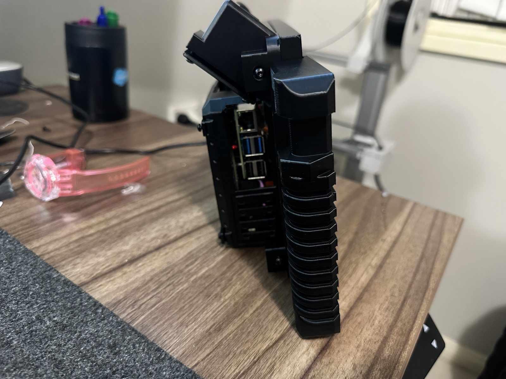
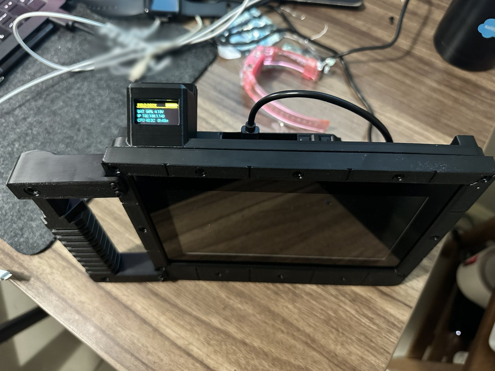
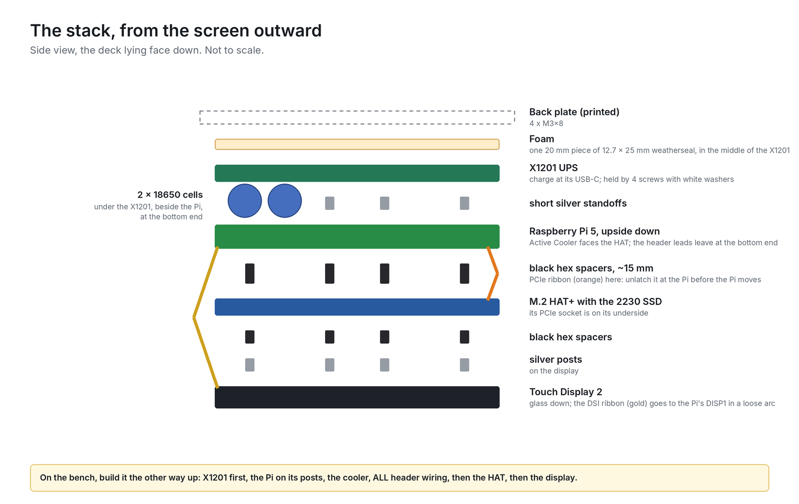
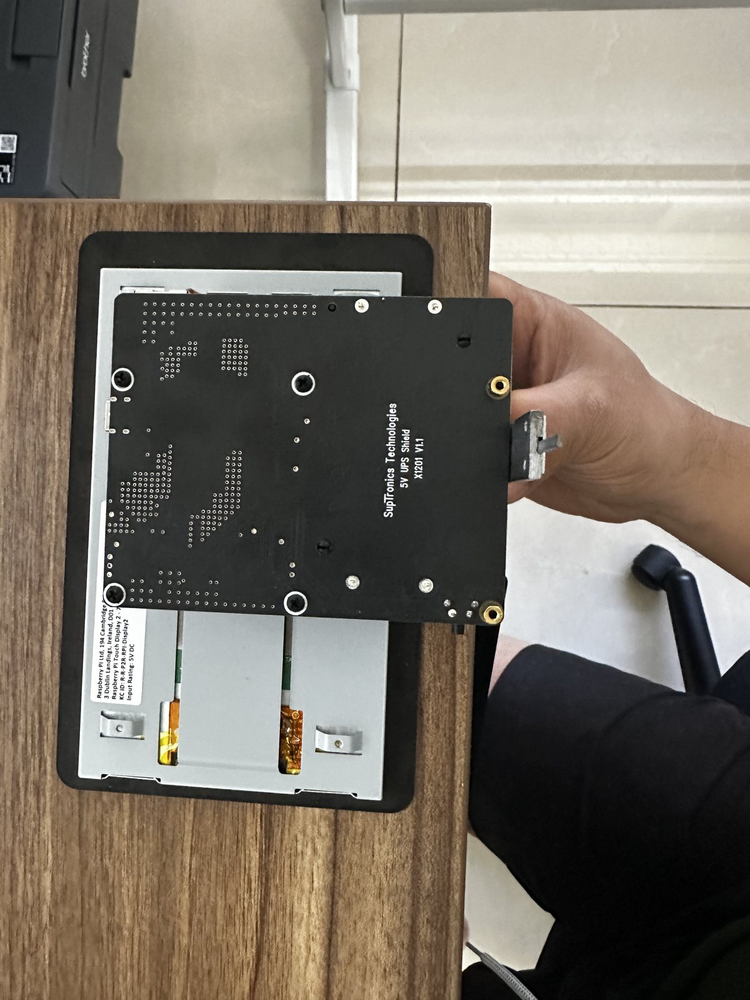
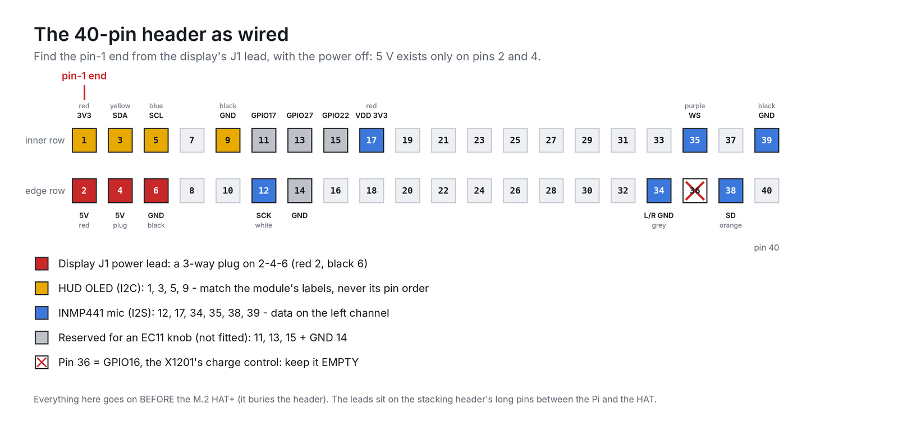
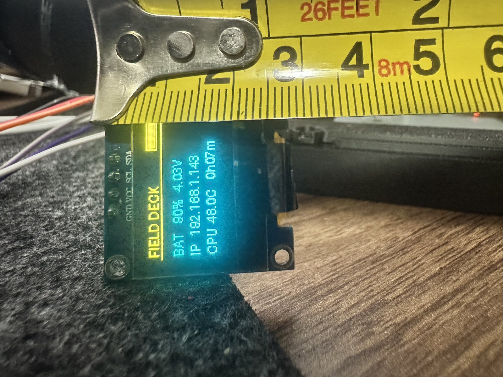
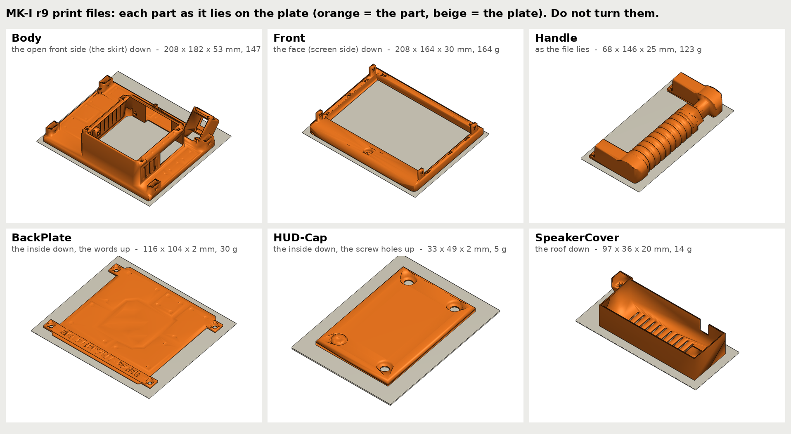
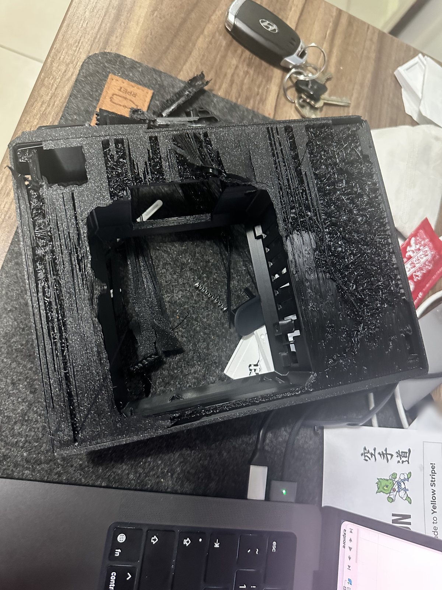
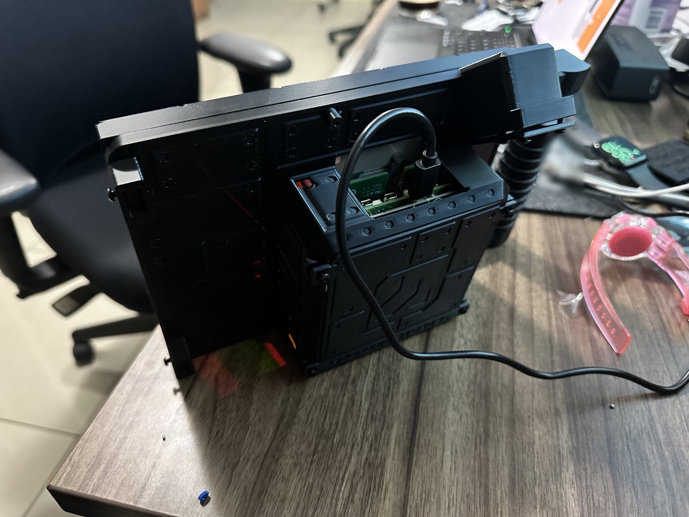

# Field Deck — Build Guide v3 (MK-I)

*selfdriven.build · a Raspberry Pi 5 cyberdeck · v3.1, 26 October 2026*


One Field Deck has been built end to end: first in temporary cases (August–September 2026), then in the printed MK-I
case (designed 1–12 October, assembled 14 October 2026). Everything below is what that build actually needed. Where
something was not tested, it says so. The full list of corrections since the first version is in
[docs/ERRATA.md](docs/ERRATA.md), and [CHANGELOG.md](CHANGELOG.md) says what changed in v3.

## Contents

1. [What you're building](#1-what-youre-building)
2. [Parts](#2-parts)
3. [Tools](#3-tools)
4. [Rules before you start](#4-rules-before-you-start)
5. [Step 1 — Flash the OS](#step-1--flash-the-os)
6. [Step 2 — Build the stack](#step-2--build-the-stack)
7. [Step 3 — Display: rotation, touch, blanking](#step-3--display-rotation-touch-blanking)
8. [Step 4 — Boot from the NVMe SSD](#step-4--boot-from-the-nvme-ssd)
9. [Step 5 — Power and charging](#step-5--power-and-charging)
10. [Step 6 — The HUD](#step-6--the-hud)
11. [Step 7 — Microphone and voice assistant](#step-7--microphone-and-voice-assistant)
12. [Step 8 — Print the MK-I case](#step-8--print-the-mk-i-case)
13. [Step 9 — Put the deck in the case](#step-9--put-the-deck-in-the-case)
14. [Step 10 — Heat and power check](#step-10--heat-and-power-check)
15. [Everyday use](#everyday-use)
16. [Troubleshooting](#troubleshooting)
17. [Designing your own case — lessons](#designing-your-own-case--lessons)
18. [Still unverified](#still-unverified)

---

## 1. What you're building

| | |
|---|---|
| Computer | Raspberry Pi 5, 8 GB, with the official Active Cooler |
| Screen | Raspberry Pi Touch Display 2, 7-inch (a 720 × 1280 portrait panel, used in landscape) |
| Storage | Official Raspberry Pi 512 GB SSD Kit (2230 NVMe SSD + M.2 HAT+). It boots from the SSD; a microSD card is the backup |
| Power | Geekworm / SupTronics X1201 UPS board with two Samsung 35E 18650 cells in parallel (about 25 Wh). Charge it with the official 27 W USB-C supply |
| HUD | A 0.96-inch SSD1306 OLED (yellow/blue, 128 × 64) on I2C showing battery, IP address, CPU temperature and uptime |
| Voice | INMP441 I2S microphone → whisper.cpp → Ollama (llama3.2:3b) → Piper → Bluetooth speaker. Wake phrases "hey octo", "hello octo" or just "octo". All of it runs on the deck, offline |
| Case | MK-I: six PETG parts plus a printed power lever and a retainer ring, printed on a Bambu Lab A1. About 271 × 182 × 65 mm with the grip, standing at 12° |
| OS | Raspberry Pi OS (64-bit) based on Debian 13 "trixie" |
| Cost | About A$1,020 for the essential parts plus shipping; A$1,260 with every optional line (2026 prices), plus a few extras (section 2) |

**What works on the reference deck:** booting from NVMe, charging, running on battery, the HUD, the microphone, speech to
text, the local model and speech out through a Bluetooth speaker. **Not yet measured:** a timed battery run, and a 30-minute
full-load heat test with the case closed ([Step 10](#step-10--heat-and-power-check)).

| | | |
|---|---|---|
|  |  |  |
| Grip side: Ethernet and USB | Top: the HUD and the charging socket | The back plate |

---

## 2. Parts

### Core parts

Prices are what this build paid in Australia in mid-2026 (AUD, including GST).

| Item | Part | Qty | A$ | From | Notes |
|---|---|---|---|---|---|
| Computer | Raspberry Pi 5, 8 GB | 1 | 285.65 | Core Electronics | |
| Cooling | Official Active Cooler | 1 | 8.80 | Core Electronics | |
| Storage | Official Raspberry Pi 512 GB SSD Kit (2230 SSD + M.2 HAT+) | 1 | 209.58 | Core Electronics | Includes a 16 mm stacking header. Only 2230/2242 SSDs fit the HAT+ |
| Backup card | SanDisk Extreme microSD 32 GB, A1 | 1 | 38.99 | Amazon AU | |
| Screen | Raspberry Pi Touch Display 2, 7-inch | 1 | 106.36 | Core Electronics | Comes with the DSI ribbons and the J1 power lead |
| Keyboard | Royal Kludge RK61 (60 %, wired USB-C) | 1 | 75.99 | CozyDev | Any small USB keyboard |
| UPS | Geekworm X1201 (2 × 18650, pogo pins) | 1 | 90.63 | Amazon AU | Cells not included |
| Cells | Samsung 35E 3500 mAh 18650, flat-top, unprotected | 2 | 49.90 | Jaycar | Flat-top ~65 mm cells fit; protected cells were never tried |
| Filament | Bambu PETG HF, 1 kg | 1 | 36.00 | Core Electronics | The MK-I case uses about 490 g |
| Fixings | M2.5 nylon standoff and screw set | 1 | 35.30 | Core Electronics | |
| Cable | Short right-angle USB-C cable | 1 | 11.99 | Amazon AU | |
| Fixings | Heat-set insert kit, M2–M6 | 1 | 22.99 | Amazon AU | Not used by the MK-I case |
| Power supply | Official Raspberry Pi 27 W USB-C (5.1 V / 5 A) | 1 | ~21.07 | Core Electronics | A laptop USB-C charger is not enough (5 V / 3 A) |
| Hub *(optional)* | 4-port USB 3.0 hub | 1 | 29.95 | Jaycar | |
| SDR *(optional)* | RTL-SDR Blog V3 + dipole kit | 1 | 184.95 | Core Electronics | Never tested on this build |
| HUD | 0.96" I2C OLED, SSD1306, yellow/blue 128 × 64 | 1 | 15.90 (for 2) | eBay AU | |
| Knob *(optional)* | EC11 rotary encoder with switch | 1 | 9.95 | Jaycar | Not fitted |

Total as bought, every line: **A$1,260.59** (A$1,239.52 billed, including A$26.59 shipping, plus the power supply at an
estimated A$21.07). The essentials alone, with shipping: A$1,019.84. Full detail, including what was billed when, is in
[docs/BOM.md](docs/BOM.md).

### Added since v2

| Item | Part | Qty | Notes |
|---|---|---|---|
| Microphone | INMP441 I2S MEMS module | 1 (+ spares) | Pins come loose: you solder them. A pack of six cost A$26.87 on AliExpress. One of the two tried worked |
| Mic leads | 150 mm female–female jumpers (e.g. Jaycar WC6026) | 6 | Long enough for the MK-I chin |
| OLED extension leads | Male–female jumpers, 150–200 mm | 4 | The MK-I's HUD sits by the grip, further from the header |
| Case screws | M3 × 8 button head, hex socket (this build: uxcell B01B1OD62C) | 26 | 18 for the case, 8 for the retainer ring. No inserts |
| Foam tape | Double-sided foam tape | a little | Holds the OLED (and the mic) |
| Screen foam | Moroday 12.7 × 25 mm garage weatherseal (Bunnings, I/N 4114639) | 20 mm | Holds the screen forward in the case |
| Speaker | Any Bluetooth speaker | 1 | The deck has no speaker inside yet |

---

## 3. Tools

- A **T9 Torx bit** for the M3 button heads. These screws have shallow hex sockets: a 2 mm hex key cammed out of them
  on two different keys and rounded one socket. A T9 grips better. (A 2 mm hex key works if you are careful.)
- A slim driver with a ~65 mm shaft, for one case screw that sits deep.
- A soldering iron **with temperature control**, solder and a damp sponge (not steel wool), for the microphone's pins.
  A fixed-heat iron gave cold joints and melted the header plastic in this build.
- A breadboard to hold the header pins straight while you solder.
- A multimeter with a diode test.
- Calipers. Read them at the vernier's zero line — see [lessons](#designing-your-own-case--lessons).
- Flush cutters, pliers, a needle or paper clip, and 120-grit sandpaper.

---

## 4. Rules before you start

> [!WARNING]
> Each of these cost this build time, and one nearly cost a part. Read them first.

1. **Power goes into the X1201's USB-C only — never the Pi's.** The X1201 feeds the Pi through pogo pins. Powering the Pi
   directly runs the deck but never charges the cells, and with the X1201 fitted it risks feeding power back into it.
2. **Before you touch the 40-pin header:** unplug the charger and keep it out (plugging it in starts the deck), then
   `sudo poweroff`, then check that every light is off: the Pi, the HAT, the X1201, the OLED and the screen. This only works
   once `POWER_OFF_ON_HALT=1` is set ([Step 5](#step-5--power-and-charging)). Never fit, move or probe wires on a live header.
3. **Find pin 1 from the display's J1 lead, with the power off.** The J1 lead sits on pins 2 and 6, and 5 V exists only
   on pins 2 and 4 — so the end carrying J1 is the pin-1 end. Pin 1 is the end pin of the *other* (inner) row. Don't work
   it out from a pinout picture or the USB-C socket.
4. **Everything that goes on the header goes on before the M.2 HAT+.** The HAT buries the header.
5. **Don't lift the Pi out of an assembled stack.** It works the PCIe ribbon loose; the deck then shows a steady red and
   a solid green LED and won't boot. If you must open the stack, unlatch the ribbon first ([Step 2](#opening-a-finished-stack)).
6. **Never use `dtoverlay=googlevoicehat-soundcard`** (the overlay most INMP441 guides use). It drives GPIO16, which is
   the X1201's charge control. Keep pin 36 (GPIO16) empty.
7. **Never probe across two neighbouring pins** — on the mic, the OLED or the header. On the mic, a probe touching VDD
   and GND together shorted 3.3 V and switched the deck off. Measure each pin against the metal shell of a USB port.
8. **Treat the display ribbon gently.** This build broke the latch of DISP0 and runs on DISP1.

---

## Step 1 — Flash the OS

1. In Raspberry Pi Imager choose **Raspberry Pi OS (64-bit)** with the desktop. The reference deck runs the Debian 13
   "trixie" release.
2. In Imager's settings set the hostname, user, password and Wi-Fi. **Enable SSH on the *Services* tab** — it is off by default.
3. Flash the microSD card first. You will move to the SSD in [Step 4](#step-4--boot-from-the-nvme-ssd).
4. After the first boot, find the deck's IP address on your router (`hostname.local` was unreliable), then set up key
   login from your computer:

   ```bash
   ssh-copy-id <user>@<deck-ip>
   ```

   If SSH times out on a running deck, keep pinging it for a few minutes. In this build it was silent for minutes, then
   answered (most likely Wi-Fi power saving). Once the HUD runs ([Step 6](#step-6--the-hud)), it shows the IP address.

---

## Step 2 — Build the stack



**In the finished deck, from the screen outward:** Touch Display 2 → its silver posts → black hex spacers → M.2 HAT+
(with the SSD) → black hex spacers (~15 mm) → Raspberry Pi 5, upside down, Active Cooler facing the HAT → short silver
standoffs → X1201 (its cells sit under it, beside the Pi, at the bottom end) → foam → back plate.



*The real stack on the back of the screen (September 2026, before the MK-I case).*

**On the bench, build it the other way up:**

1. **X1201** at the bottom. **Leave the cells out** until the stack is finished — with cells in, the X1201 can power
   the Pi while you work on the header. (If they are in, check that no LED is lit before step 4.)
2. **Pi 5** directly on the X1201's own posts — no extra spacers in between — so the pogo pins land on the Pi's underside.
   (Extra spacers here were this build's biggest time sink in August.)
3. **Active Cooler** on the Pi.
4. **Everything on the 40-pin header — now**, before the HAT:
   - the display's **J1 power lead**: a 3-way plug covering pins 2-4-6 (red on 2, black on 6);
   - the **OLED harness** ([Step 6](#step-6--the-hud));
   - the **microphone leads**, if you fit the mic ([Step 7](#step-7--microphone-and-voice-assistant)).

   In this build the leads sit on the long pins of the kit's 16 mm stacking header, between the Pi and the HAT.
   Label the far ends.
5. **Display ribbon into DISP1** (CAM/DISP1) while you can still reach it. Use the display's "standard-mini" ribbon:
   the Pi 5 has the small 22-way connectors.
6. **M.2 HAT+** on ~15 mm of spacers over the cooler. PCIe ribbon: gold contacts toward the USB ports at the Pi end and
   toward the SSD side at the HAT end; push each end fully home and close both latches.
7. **The display** on top: the stack mounts on its posts. Then fit the cells (watch the polarity marks on the holders).

### The header as wired



| Pin | Signal | Used by | Wire |
|---|---|---|---|
| 1 | 3V3 | OLED VCC | red |
| 2 | 5V | display J1 | red |
| 3 | GPIO2 (SDA) | OLED SDA | yellow |
| 4 | 5V | covered by the J1 plug | — |
| 5 | GPIO3 (SCL) | OLED SCL | blue |
| 6 | GND | display J1 | black |
| 9 | GND | OLED GND | black |
| 12 | GPIO18 (I2S clock) | mic SCK | white |
| 17 | 3V3 | mic VDD | red |
| 34 | GND | mic L/R (data on the left channel) | grey |
| 35 | GPIO19 (I2S frame) | mic WS | purple |
| 36 | GPIO16 | **keep empty** — X1201 charge control | — |
| 38 | GPIO20 (I2S data in) | mic SD | orange |
| 39 | GND | mic GND | black |
| 11, 13, 15, 14 | GPIO17, 27, 22, GND | reserved for an EC11 knob (not fitted) | — |

Nothing plugs onto the header for the X1201, the HAT or the display picture: they connect through pogo pins, the PCIe
ribbon and the DSI ribbon. The X1201's pogo pins do reach the same signals, though — its battery gauge shares the I2C bus
(at `0x36`) and it uses GPIO16, which is why pin 36 stays empty.

### Opening a finished stack

You will need this if you add wiring later (this build opened it once, to add the microphone):

1. Charger out, then `sudo poweroff`, then check every light is off ([rule 2](#4-rules-before-you-start)).
2. Take the X1201 off: four screws with white washers, undone in a cross pattern. Put it down cells-up, away from metal.
3. **Unlatch the PCIe ribbon at the Pi's white socket and slide it out before the Pi moves at all.**
4. Lift the Pi gently. Leave the display ribbon in DISP1, in a loose arc, and never let the Pi hang from it.
5. Fit your leads, finding pin 1 from J1.
6. Back in reverse: ribbon contacts toward the USB ports, latch closed. The four short silver standoffs came away with the
   X1201 — screw them back in by hand, through the Pi's holes into the black spacers, before the X1201 goes on. Without
   them the Pi isn't clamped, and the X1201 cuts the power within seconds if its pogo pins lose the Pi. Then the X1201,
   with its cells on the header side so its pogo pins land.
7. A steady red plus solid green LED afterwards means the PCIe ribbon isn't seated: reseat both ends.

---

## Step 3 — Display: rotation, touch, blanking

- **Rotation.** The panel is portrait. Open *Raspberry Pi menu → Preferences → Control Centre → Screens*, right-click the
  DSI screen (DSI-1 on this build) → *Orientation → Left* or *Right* → *Apply*. Choose by eye; this build uses *Right*.
- **Touch.** Then tap the four corners: touch doesn't always turn with the picture. If taps land in the wrong place, the
  display overlay's touch options (`invx`, `invy`, `swapxy`) fix it.
- **Screen blanking.** It was off on this build, so the screen never turned off. *Control Centre → Display → Screen
  Blanking* on → *Close* → restart. The screen then goes dark after 10 minutes without a touch or key press; a tap wakes it.
- **Battery tip.** The backlight is roughly a third of the idle power draw (an estimate), so dimming it helps most.

---

## Step 4 — Boot from the NVMe SSD

1. With the deck running from the microSD card, copy it to the SSD with `rpi-clone` (it updates the partition IDs for you).
2. Set the boot order in the bootloader — do this together with the power settings in
   [Step 5](#step-5--power-and-charging), as one edit: `BOOT_ORDER=0xf416` (NVMe first, then SD, then USB, then restart).
   The default is `0xf461`.
3. Reboot. The deck boots from the SSD; the card stays as a backup.

---

## Step 5 — Power and charging

### The bootloader (EEPROM)

```bash
sudo rpi-eeprom-config --edit
```

Make sure these three lines are there, save, and reboot:

```ini
BOOT_ORDER=0xf416
PSU_MAX_CURRENT=5000
POWER_OFF_ON_HALT=1
```

Read it back afterwards with `sudo rpi-eeprom-config`. The reference deck's full config is in
[config/eeprom.conf](config/eeprom.conf).

- `PSU_MAX_CURRENT=5000` tells the Pi it has 5 A: the X1201 feeds it through pogo pins, so the Pi can't ask the
  supply itself. Without it you get the "not capable of 5 A" warning.
- `POWER_OFF_ON_HALT=1` makes `sudo poweroff` really turn the deck off. Without it the Pi only halts: the X1201 keeps
  powering it, a red LED stays on, the OLED freezes on its last picture and the deck slowly drains the cells (about
  1.5 W, roughly a day to empty).

### config.txt

Add these at the end of `/boot/firmware/config.txt` (the reference deck's lines are in
[config/boot-firmware-config.txt](config/boot-firmware-config.txt)):

```ini
[all]
usb_max_current_enable=1
gpio=16=op,dl
```

`gpio=16=op,dl` holds GPIO16 low, which is "charging on" on the X1200-series boards. It is a precaution: the pack also
charged without it. The microphone adds one more line in [Step 7](#step-7--microphone-and-voice-assistant).

### Using the power

- **Charge** with the official 27 W supply in the **X1201's** USB-C. In the MK-I case that is the socket in the top
  opening, on the grip side of the two micro-HDMI ports; the Pi's own USB-C is closed off behind the wall.
- **Turn on:** plug in the charger (the deck starts by itself), or press the X1201's button — in the MK-I case, the printed
  lever at the bottom corner of the side without the grip.
- **Turn off:** unplug the charger, then `sudo poweroff`; the X1201 cuts the power once the Pi is down. The button acts
  like the Pi 5's own power button — on the desktop one press shows the shutdown menu and a second press shuts down —
  but that wasn't tried on this deck.
- **Is it charging?** Watch the *voltage* on the HUD: it should rise within about 10 minutes, and the X1201's 25/50/75/100 %
  LEDs light. The *percentage* is an estimate from a voltage model (the MAX17040 gauge reads one cell, 3.0–4.2 V, because
  the cells are in parallel). On the charger it settles in the mid-to-high 90s, never 100 %: the X1201 stops charging
  near 4.23 V and starts again at 4.1 V. That is normal.
- Expect 3–4 hours from flat. Below about 3.0 V the charger trickles slowly at first, by design.
- **Runtime:** about 4.7 hours idle — an estimate from a 14-minute reading, not a timed run. Much less while the local AI
  works. There is no automatic low-battery shutdown, so shut down by about 3.4 V.

---

## Step 6 — The HUD



### Wiring

With the power off, wire the OLED to pins **1 (VCC), 3 (SDA), 5 (SCL), 9 (GND)** — see [the header map](#the-header-as-wired).
These modules ship with the pins in different orders (GND-VCC-SCL-SDA or VCC-GND-SCL-SDA). **Match each wire to the
label printed beside the pin, never to its position:** swapping VCC and GND kills the module. In the MK-I case the HUD
sits by the grip, so add four 150–200 mm male–female extension leads.

Then power on and check at the **OLED end** (not at the header):

- VCC reads 3.3 V against the metal shell of a USB port (don't probe between two neighbouring pins);
- `i2cdetect -y 1` shows `36` (the X1201's battery gauge) and `3c` (the OLED).

If I2C isn't on yet: `sudo raspi-config nonint do_i2c 0`, then reboot. (A meter at the header can't single out pin 1
anyway: pins 3 and 5 also read 3.3 V through the I2C pull-ups.)

### Software

The HUD is one Python file run by a service. It shows "FIELD DECK" with a battery icon, then `BAT nn% x.xxV`, the IP
address, and the CPU temperature with the uptime, refreshed every 2 seconds. Files and details:
[software/hud/](software/hud/README.md).

```bash
python3 -m venv --system-site-packages ~/hud
~/hud/bin/pip install luma.oled smbus2
cp software/hud/hud.py ~/hud/hud.py
sed "s/YOURUSER/$USER/g" software/hud/hud.service | sudo tee /etc/systemd/system/hud.service > /dev/null
sudo systemctl daemon-reload
sudo systemctl enable --now hud
```

**Which way up:** fit the OLED with its 4 header pins at the **top** — in the MK-I they have to be at the top, because
there is no room for the plugs below. On this build the picture is then upright. If yours is upside down, add `rotate=2`:

```bash
sed -i 's/height=64)/height=64, rotate=2)/' ~/hud/hud.py && sudo systemctl restart hud
```

---

## Step 7 — Microphone and voice assistant

The deck has no audio of its own: the Pi 5 has no headphone jack and the Touch Display 2 has no speakers. This build adds
an I2S microphone on the header and plays sound through a Bluetooth speaker.

### 7.1 The microphone

1. **Solder the INMP441's pins.** Hold the header straight in a breadboard. Use a temperature-controlled iron, tin the tip
   and clean it on a damp sponge. Then check every joint with the meter's diode test, deck off and mic unplugged: black on
   VDD and red on each pin in turn (or red on GND and black on each pin). About 400–800 means the joint connects; no
   reading means it doesn't. In this build two joints (GND and WS) looked fine but hadn't bonded to their pads.
2. **Wire it** with the power off (needs the header: before the HAT, or [open the stack](#opening-a-finished-stack)):
   SCK → 12, WS → 35, SD → 38, L/R → 34 (ground: data on the left channel), VDD → 17, GND → 39.
   Plug the leads on by the labels on the **solder side** — seen from the plug side the rows read mirrored.
3. **Turn it on.** Add this under `[all]` in `/boot/firmware/config.txt`, then reboot:

   ```ini
   dtoverlay=adau7002-simple
   ```

   `arecord -l` should then list `adau7002`.
4. **Test it** (10 seconds, speak):

   ```bash
   arecord -D hw:CARD=adau7002,DEV=0 -f S32_LE -r 48000 -c 2 -d 10 ~/mic_test.wav
   python3 -c "import wave,array,math; w=wave.open('$HOME/mic_test.wav'); a=array.array('i', w.readframes(w.getnframes())); l=a[0::2]; p=max(abs(x) for x in l); print('left peak %.1f dBFS; zero samples %d, all-ones samples %d, of %d' % (20*math.log10(max(1,p)/2**31), l.count(0), l.count(-1), len(l)))"
   ```

   Judge it by those numbers rather than `arecord`'s `-V` meter. On this build a take with claps and speech peaked at
   −14 dBFS; quiet speech at arm's length is much lower. If nearly every sample is zero, the mic isn't driving its data
   line (a joint or the wiring); if nearly every sample is "all-ones", the plugs are swapped.

### 7.2 Sound out

1. Pair the Bluetooth speaker from the Bluetooth icon in the top bar (*Add Device*). Choose the output by long-pressing
   (or right-clicking) the volume icon.
2. Install the PipeWire ALSA plugin, so programs that use `aplay` reach the speaker:

   ```bash
   sudo apt install -y pipewire-alsa
   ```

   Without it, `aplay` fails with `audio open error: Unknown error 524`: ALSA's default device was the HDMI output.
   If it is silent, `wpctl status` shows where the sound goes.

### 7.3 The voice pipeline

**whisper.cpp** (speech to text, offline):

```bash
sudo apt install -y git cmake build-essential
git clone https://github.com/ggml-org/whisper.cpp.git ~/whisper.cpp
cd ~/whisper.cpp
sh ./models/download-ggml-model.sh base.en
cmake -B build
cmake --build build -j4 --config Release
./build/bin/whisper-cli -m models/ggml-base.en.bin -f samples/jfk.wav -nt
```

On the Pi 5 the 11-second sample transcribed in about 2.5 seconds.

**Ollama** with the model (the official installer, then the model):

```bash
curl -fsSL https://ollama.com/install.sh | sh
ollama run llama3.2:3b
```

The first run downloads the model and opens a chat; type `/bye` to leave.

**Piper** (text to speech):

```bash
sudo apt install -y python3-venv
python3 -m venv ~/voice
~/voice/bin/pip install piper-tts
~/voice/bin/python -m piper.download_voices --download-dir ~/piper-voices en_GB-vctk-medium
~/voice/bin/python -m piper -m ~/piper-voices/en_GB-vctk-medium.onnx -s 71 -f /tmp/octo.wav "G'day, I'm Octo."
aplay /tmp/octo.wav
```

Piper has no Australian English voice; speaker 71 of the British multi-speaker voice is the stand-in. Octo turns the
voice's pitch and timing variation up a little and speaks a touch quicker, so it sounds less flat (below).

### 7.4 Talking to it

Copy [software/voice/octo.py and talk.py](software/voice/README.md) to your home folder.

- `~/voice/bin/python ~/octo.py` — hands-free, with speech. Say **"Hey Octo"**, **"Hello Octo"** or just **"Octo"** and
  your question in one go ("Hey Octo, what's the time?"), or say the name, wait for its reply ("Yes?", "Yep?",
  "What's up?" or "Go on.") and finish your question within about 7 seconds. Ctrl+C quits.
- `python3 ~/talk.py` — push to talk (Enter, speak, Enter), text only.

Settings can be changed with environment variables: `TALK_MODEL`, `TALK_WMODEL`, `TALK_VOICE`, `TALK_SPEAKER`,
`TALK_WAKE` (a comma-separated list), and for the voice `TALK_EXPRESS` (pitch movement, default 0.85), `TALK_RHYTHM`
(timing variation, 1.0) and `TALK_PACE` (under 1 is quicker, 0.92) — see [software/voice/README.md](software/voice/README.md).

**Limits:** there is no echo cancelling, so the mic is muted while Octo speaks (you can't interrupt it). English only;
for faster transcription use a `tiny.en` model. It runs in a terminal, not as a service. "Mic busy" means another
recording is running: `pkill arecord`.

---

## Step 8 — Print the MK-I case



The files are in [print/MK1-r9/](print/MK1-r9/MK1-r9_HOW-TO-PRINT.md). Each one already lies the right way up — **don't
turn them in the slicer.**

### Settings for every part

Bambu Studio — turn on *Advanced* in the process settings, then save your own preset:

- Bambu Lab A1, 0.4 mm nozzle, Textured PEI plate.
- Bambu PETG HF at its own temperatures. **Dry it first.**
- Start from "0.20mm Standard @BBL A1", then: layer height 0.2, first layer 0.2; X-Y hole compensation **0**, X-Y contour
  compensation 0, elephant foot compensation 0.15; **4 wall loops**, 20 % sparse infill; skirt loops 0.
- Support **off** and brim **"No-brim"** for every part except the body.

### The parts, in this order

| # | Part | File | Lies | Support | Brim | Size (mm) | ≈ g |
|---|---|---|---|---|---|---|---|
| 1 | Body | `MK1-r9-Body_PRINT-THIS.stl` | open front down | **ON** (below) | outer, 5 mm | 208 × 182 × 53 | 147 |
| 2 | Front | `MK1-r9-Front_PRINT-THIS.stl` | face down | off | No-brim | 208 × 164 × 30 | 164 |
| 3 | Handle (grip) | `MK1-r9-Handle_PRINT-THIS.stl` | as it lies | off | No-brim | 68 × 146 × 25 | 123 |
| 4 | Back plate | `MK1-r9-BackPlate_PRINT-THIS.stl` | inside down, words up | off | No-brim | 116 × 104 × 2.5 | 30 |
| 5 | HUD cap | `MK1-r9-HUD-Cap_PRINT-THIS.stl` | inside down | off | No-brim | 33 × 49 × 2.5 | 5 |
| 5 | Speaker cover | `MK1-r9-SpeakerCover_PRINT-THIS.stl` | roof down | off | No-brim | 97 × 36 × 21 | 14 |

- **Body:** support normal (auto), threshold 30°, *on build plate only*, *remove small overhangs* on, **top Z distance
  0.3**. It holds up the roof inside the skirt and comes out through the open back. Only a thin rim touches the plate,
  hence the brim. A trial slice (before the brim and the 0.3 top Z distance were set) came to 6 h 41 min and 147.7 g,
  including about 22.5 g of support and interface.
- **Front:** support off, or the slicer fills the marks and grooves in the face.
- **Handle:** the grip's grooves print as short bridges.
- **Back plate:** in the preview, check that every letter of the words shows.
- **HUD cap and speaker cover** go on one plate. The cover's screw ears start as short bridges.
- The grams are from the solid volume; only the body was sliced for real.

### Two more printed parts

- **Power lever** — [print/MK1-r9/extra/](print/MK1-r9/extra/MK1-Button-Lever_r8fix2_HOW-TO-PRINT.md): one file holds three
  levers (two are spares). **PETG, not PLA** — the lever is a spring. Support off, outer brim 5 mm, about 3 g for all three.
  Scrape any bump off the rounded tip: it is what presses the button.
- **Retainer ring** (`C1-RetainerRing.stl`, reused from the earlier C1 case): it screws in over the screen's border inside
  the front. In the MK-I its pads sit about 7 mm above the glass border and touch nothing — the foam behind the stack is
  what holds the screen forward, so don't leave the foam out. Print it flipped, recess side down, no supports.

### After printing



- **Body:** the PETG support interface welds onto the underside of the skirt roof. Peel it with pliers and scrape it
  flat (there is only 1.5 mm of room there), finish with 120 grit. No heat gun.
- **Front:** poke the microphone's pinhole clear with a needle or a straightened paper clip.
- **Back plate:** lay it on the table — it must not rock.

---

## Step 9 — Put the deck in the case

**Screws:** 18 × M3 × 8 for the case (back plate 4, HUD cap 3, grip 4, body to front 4, speaker cover 2, power lever 1)
plus 8 for the retainer ring. They cut their own thread in the printed holes: no drill, no inserts. Stiff the first time;
snug, never tight. **Don't use M3 × 10** — it would bottom out in the back plate, HUD cap, grip and speaker-cover holes.
Those joints and the lever were checked with a real screw's length
([cad/checks/](cad/checks/MK1_r9_screw_real_length_checks.txt)); the body-to-front and ring screws were not.

1. **Screen and stack into the front.** Seat the display in its pocket, the retainer ring over it, 8 × M3 × 8, snug.
2. **Microphone into the chin pocket:** letters down, pin rows along the two slots, pressed in flat by hand (a ring of
   double-sided foam tape holds it, no rattle). Snip any pin ends longer than 2.5 mm. Run the leads under the cells; the
   mic and OLED leads leave the stack at the bottom end.
3. **OLED leads** (with their extensions) laid in the cavity behind the screen.
4. **Power lever out**, if it is fitted: it comes out before the body goes on or comes off.
5. **Body onto the front.** Pull the OLED plugs out through the rear opening of the HUD tube as you lower it. It must sit
   down all round without rocking. 4 × M3 × 8 through the side walls into the front's bosses — snug only, there is 0.8 mm
   of plastic under each head. **Do the lower one on the grip side now** (the grip covers it); the slim driver reaches it.
6. **Grip:** 4 × M3 × 8 through its holes into the front.
7. **Power lever:** in from outside, at the bottom corner of the side without the grip, 1 × M3 × 8. Press it: a little
   free travel, then the button clicks.
8. **OLED:** header pins at the **top**. A 3 mm square of double-sided foam tape over each of its 4 corner holes, on the
   screen side (not on the glass). Peel the backing, plug the leads on, slide it in from the back and press the 4 corners
   onto the posts. No screws.
9. **HUD cap:** 3 × M3 × 8 — tighten the two top ones gently (1.5 mm of plastic beside them).
10. **Speaker cover:** 2 × M3 × 8. It goes on empty for now (the speaker is Bluetooth).
11. **Foam:** cut one 20 mm piece of the weatherseal and stick it in the middle of the X1201's back, between its four
    screws. It holds the screen forward.
12. **Back plate:** 4 × M3 × 8. It should lie flat. Tilt and shake the deck: the screen must not move.

If you carry the deck by its grip with cables plugged in, use right-angle plugs on the grip side.



---

## Step 10 — Heat and power check

**Idle:** about 48–50 °C with the case closed is normal. Raspberry Pi's own figure for a Pi 5 with the Active Cooler and
an M.2 HAT is about 49 °C. The Pi starts slowing itself down at 80 °C and 85 °C is the limit.

**Full load, case closed, charger in, 30 minutes** (the local AI is the real full load):

```bash
timeout 30m python3 -c "import multiprocessing as m; f=lambda: exec('while 1: pass'); [m.Process(target=f).start() for _ in range(3)]; f()"; vcgencmd get_throttled; vcgencmd measure_temp
```

Pass: `throttled=0x0`, the CPU under 80 °C, and the back warm, not hot (the cells should stay at or under 45 °C while
they charge). Stop it with Ctrl+C if the back gets hot. *This test has not been run on the reference deck yet.*

**Battery run (still owed):** from full, log the temperature, `vcgencmd get_throttled`, the start and end voltage and the
time. Stop at 3.4 V and shut down cleanly.

---

## Everyday use


- **On / off / charging:** see [Step 5](#using-the-power).
- **HUD:** battery %, voltage, IP address, CPU temperature and uptime, always on.
- **Voice:** `~/voice/bin/python ~/octo.py`, then "Hey Octo, …".
- **SSH:** by IP address — read it off the HUD on a new network.
- **Wi-Fi with a sign-in page** (offices, hotels): if no page opens, browse to `http://neverssl.com` (plain http); the
  network's sign-in page appears. On enterprise Wi-Fi (PEAP), the settings dialog doesn't fit the 7-inch screen with the
  keyboard up — use `nmcli`:

  ```bash
  nmcli connection add type wifi ifname wlan0 con-name work ssid "<SSID>" wifi-sec.key-mgmt wpa-eap 802-1x.eap peap 802-1x.phase2-auth mschapv2 802-1x.identity "<username>"
  nmcli connection up work --ask
  ```

  Office networks often block device-to-device traffic, so SSH from a laptop may not work there.
- **"Unlock keyring" prompts:** with auto-login, the login keyring stays locked, so Chromium and saved Wi-Fi ask for its
  password. If you have forgotten it, reset it (what was saved in it is lost):

  ```bash
  mkdir -p ~/old-keyring && mv ~/.local/share/keyrings/* ~/old-keyring/
  ```

  Reboot and choose a new keyring password. (An empty password stops the prompts, but saved passwords are then stored
  unencrypted.)

---

## Troubleshooting

| Symptom | Check first |
|---|---|
| Steady red + solid green LED, no boot | The PCIe ribbon: reseat both ends (latch up, push fully home, latch down) |
| Black screen, ribbon connected | The display's J1 power lead on pins 2 and 6 |
| UPS lights on, Pi dark | The Pi isn't seated on the X1201's posts — its pogo pins aren't reaching |
| "Not capable of 5 A" warning | `PSU_MAX_CURRENT=5000` in the bootloader ([Step 5](#the-bootloader-eeprom)) |
| Battery doesn't fill on mains | Charger in the X1201's port (not the Pi's) · a real 5 V / 5 A supply · then GPIO16 |
| Battery stops at 96–98 % | Normal: the X1201's charge window. Read the voltage |
| A red LED stays on after `sudo poweroff`; the OLED freezes | `POWER_OFF_ON_HALT=1` is missing |
| No `3c` in `i2cdetect -y 1` | Wires on the wrong end of the header: find pin 1 from J1, with the power off |
| HUD picture upside down | Keep the pins at the top and add `rotate=2` ([Step 6](#software)) |
| No `adau7002` in `arecord -l` | The overlay line is missing or not under `[all]`; reboot |
| The mic records all zeros | A joint or a wire (SD, WS, GND): check each joint with the diode test (Step 7.1). All-ones samples = swapped plugs |
| `aplay`: `audio open error: Unknown error 524` | `sudo apt install -y pipewire-alsa`; pick the output |
| Octo: "Mic busy" | Another recording is running: `pkill arecord` |
| Octo: "Ollama isn't answering" | Check that `ollama run llama3.2:3b` works |
| The screen never turns off | Control Centre → Display → Screen Blanking |
| No web page opens on a new Wi-Fi | A sign-in page: open `http://neverssl.com` |
| Keyring password prompts | Auto-login doesn't unlock it ([Everyday use](#everyday-use)) |
| SSH "network unreachable" | Your computer isn't on the deck's network |
| SSH "timed out" | Wi-Fi power saving (keep pinging) · office client isolation |

---

## Designing your own case — lessons

None of these is specific to this deck.

1. **Work from the maker's drawing, not just your calipers.** This build's caliper sheet was 2.6–4.4 mm short sideways:
   the vernier was read at the edge of the sliding plate, not at its zero line. Raspberry Pi's mechanical drawing of the
   Touch Display 2 places the Pi's mounting posts relative to the glass; a photo confirmed it. Read a vernier at its zero
   line, or photograph the scale.
2. **Measure small modules from a flat photo** with a known pitch in the same plane (the OLED's pixel pitch and its
   2.54 mm header). The calipers were 2–3 mm short on the OLED too.
3. **Print a small test piece** of the riskiest part first (a corner, a letter strip) before a seven-hour print.
4. **Check in the slicer, not just the model:** every layer printable, nothing floating, supports where you meant them,
   every letter visible.
5. **Prove the assembly path** for every part inside the case: the opening it passes through, the way it turns, how you
   reach its screws.
6. **Check screw lengths with the real screw.** The screws drawn in CAD here were heads only. M3 screws cut their own
   thread in 2.5 mm pilot holes in PETG; in CNC Kitchen's test such joints held about 118 kg on average.
7. **Keep X-Y hole compensation at 0** until a test print says otherwise.
8. **PETG support welds to the part:** set the support's top Z distance to 0.3.
9. **Flat parts with little bed contact curl:** give them a brim.
10. **Lettering:** print a test strip first. Black Ops One printed "S" as "8"; Orbitron Bold read better, but its "S"
    was unclear at 3.0 mm, so the names went to 3.5 mm. The back plate's 5.15 mm words, cut 0.6 mm deep, came out fine.

How the MK-I itself was made — code, Fusion 360 and the checks — is in [cad/README.md](cad/README.md).

---

## Still unverified

- A timed battery run (the ~4.7 h idle figure is an estimate).
- The 30-minute full-load heat test with the case closed.
- The SDR (never tested); a 2280 SSD and an A2 microSD card (never bought); protected 18650 cells (never tried).
- Whether `gpio=16=op,dl` is needed at all.
- An M.2 HAT+ seated on the stacking header (in this build the HAT's own header holes are empty).
- A speaker inside the case (the posts are there under the speaker cover) and the EC11 knob.

---

*Designed in Fusion 360 with Claude · printed in PETG on a Bambu Lab A1 · [selfdriven.build](https://selfdriven.build)*
