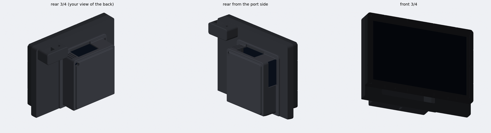
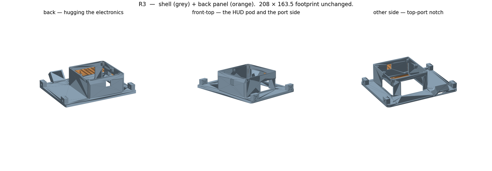
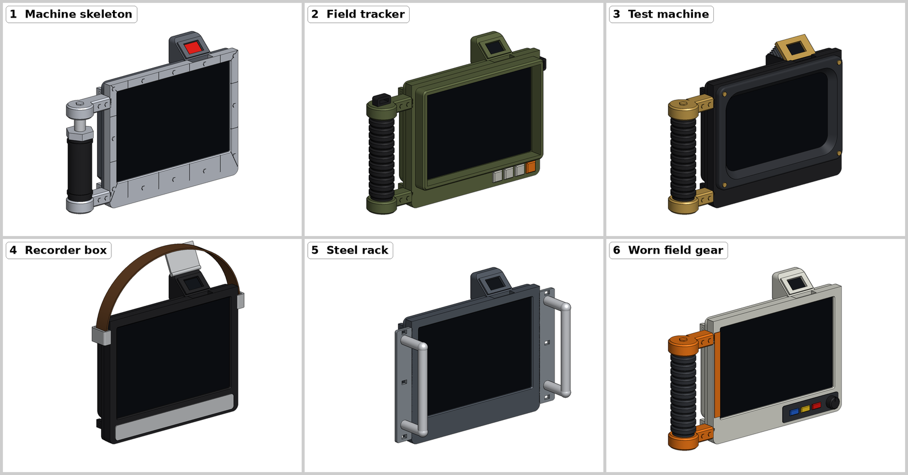
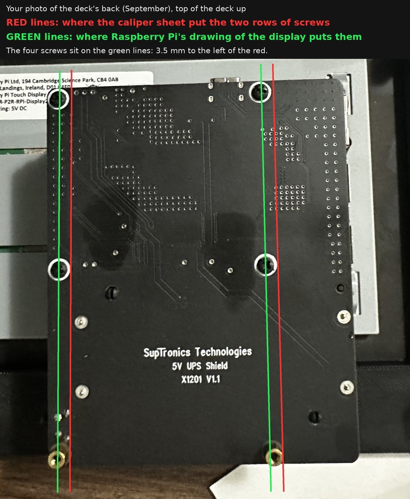
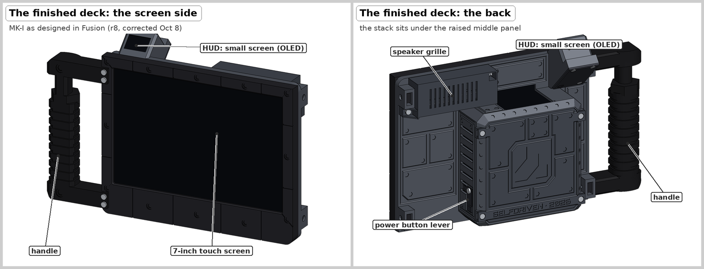
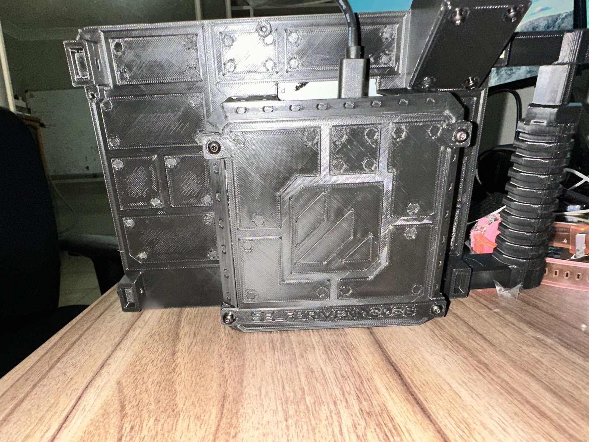
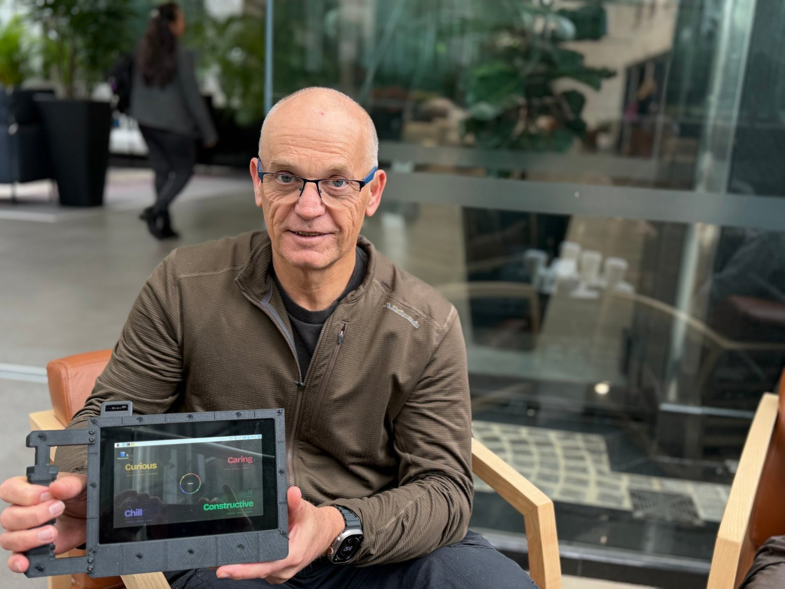

# The Field Deck journey

How one Field Deck went from the original guide to a finished MK-I between August and October 2026: the cases that
didn't work, the measurements that were wrong, and what finally did. Designed with Claude, printed in PETG on a Bambu
Lab A1.

To build one, use [BUILD_GUIDE.md](BUILD_GUIDE.md). This page is the story behind it.

## At a glance

| | |
|---|---|
| Built | August – October 2026; the MK-I case assembled on 14 October |
| Parts | about A$1,260 as bought ([docs/BOM.md](docs/BOM.md)) |
| Inside | Raspberry Pi 5 (8 GB), Touch Display 2 (7"), M.2 HAT+ with an NVMe SSD, X1201 UPS with two 18650 cells, Active Cooler, a 0.96" OLED, an INMP441 microphone |
| Case | MK-I r9: six PETG parts, about 483 g; the body alone printed in 6 h 41 min |
| Before it | a bezel-and-body case, v7 "Pebble", C1 "Bridge", R3, six style mock-ups, MK-I r1–r8 |
| Corrections | 37 errata to the original guide ([docs/ERRATA.md](docs/ERRATA.md)) |
| Software | a one-page HUD on the OLED, and Octo, an offline voice assistant |

## June – September: the guide, the first build, the first cases

- **June.** The original guide went up at `selfdriven.you/cyberdeck-build-guide` (now
  [selfdriven.build](https://selfdriven.build/cyberdeck-build-guide)). A desk audit in June and the first build in
  August found the first 14 errata. A few examples: the `BOOT_ORDER` comment was wrong (use `0xf416`), the BOM had no
  5 V / 5 A supply, SSH is off by default, and the step that moves the system to the NVMe drive was missing.
- **August: the parts and the first boot.** About A$1,260 of parts were bought. The deck booted from NVMe, the screen
  turned to landscape (it is portrait underneath: 90° or 270°, not 180°), and the OS turned out to be Raspberry Pi OS on
  Debian 13 "trixie". The display's DISP0 connector latch broke early, so the screen runs on DISP1.
- **August: the first case**, a printed bezel and a body. The bezel fitted first time. The body didn't: one print
  shifted layers, and plain slots left the ports unreachable, so later versions got funnel-shaped openings. The armour
  look (plates and hex bolts) started here.
- **5–11 September: measuring.** A caliper map of the electronics stack became "the authoritative geometry". It turned
  out to be wrong a month later (7 October, below).
- **11–12 September: v7 "Pebble"**, a tray and a pebble-shaped lid. A fresh-eyes review found five real defects: two lid
  corners with no wall at all, foot dimples cut right through, port windows that blocked the plugs, windows too tight,
  and an OLED pocket clipping a screw boss. On 12 September the build restarted with new requirements: open it every
  day without tools, easy to hold, safe in a backpack, and a HUD you can read sitting down.

  

- **12–14 September: C1 "Bridge"**, picked from three concepts: a band over the screen with the HUD on a 36° facet. It
  passed a four-pass audit on the third try, and a mirrored engraving was caught before printing. Its twist latch broke
  a catch on the second print, so screws replaced it. C1's face frame and retainer ring are still in the deck.
- **17 September: R3**, an open shell with a flat back panel: about 17 g of support instead of about 134 g. It was the
  everyday case until MK-I. What it got wrong showed up later: a shallow, sealed OLED pod (the OLED's pins had to be cut
  and wires soldered on), a power-button slot in the wrong wall because of a mirrored measurement, and a window chamfer
  a code bug never cut.

  

- **26 September.** Lifting the Pi to reach its header worked the PCIe ribbon loose, and the deck stopped booting until
  it was reseated. (The guide now says: unlatch the ribbon first.)
- **27 September: the HUD's first light.** An SSD1306 OLED on header pins 1, 3, 5 and 9, driven by `luma.oled`. Finding
  pin 1 took days; the answer was already there: the display's own power lead sits on pins 2 and 6 and marks the pin-1
  end.
- **28 September.** The guide's v2 change list: errata E15–E24.

## 1–5 October: a new case, a style, MK-I r1–r7

- **1 October: the brief.** An armoured, retro sci-fi front built on C1's proven screen pocket; designed together in one
  Fusion 360 file through its MCP connector; and a grip on the **left**, so a right-handed person can hold the deck in
  the left hand and type with the right.
- **2 October: six style mock-ups.** One rule: borrow a style, never copy a prop, and no film names on any part. The pick
  was number 1, the machine skeleton, with a grooved grip.

  

- **2–5 October: MK-I r1 to r7.**
  - **r1** made style 1 into real parts: C1's frame with armour, a separate grip with a grooved handle, and R3's shell
    with a moved HUD pod.
  - **r2** tried a closed pebble back with the HUD in the middle. It covered both HDMI ports, so the HUD moved to the
    grip side, picked from a picture. That also settled what "left" means: left as seen from the front.
  - **r3** made the back faceted and the HUD a straight tube beside the grip, with a three-screw cap. Two checks ran on
    every revision from then on: can the OLED get in along a straight path, and can a screwdriver reach every screw?
  - **r4** put the armour on the body. The closed back had been costing about 105 g of support, so **r5** turned it into
    a screwed back plate on four ears. Body and plate came to about 182 g, against about 175 g plus 105 g of support.
  - The power button is a small right-angle switch on a corner of the X1201. **r6** (a loose push pin) failed review;
    **r7** has a printed spring lever held by one screw.

## 6–8 October: sound, lettering, and the measuring mistake

- **Sound.** A ready-made mic-and-speaker board was dropped after user reports that it cuts out on Pis. INMP441
  microphones were used instead. The trap with them: the overlay most guides use, `googlevoicehat-soundcard`, drives
  GPIO16, which is the X1201's charge control. Sound out goes over Bluetooth.
- **Lettering.** The first test strip, in Black Ops One, printed a name so thin that its S read as an 8, because the
  letter's bars were thinner than one printed line. A survey of 95 open-licence fonts led to Orbitron Bold. A second
  strip still showed an unclear S at 3 mm, so the names went to 3.5 mm.
- **7 October: the caliper sheet was wrong.** It had been read at the edge of the sliding jaw instead of the vernier's
  zero line, so readings came out 2–3 mm short: the mic board is 13.94 mm, not 11.94; the knob's thread is M7, not
  "4.68". Raspberry Pi's drawing of the display, checked against a photo, put the stack 3.4–4.4 mm further from the grip
  side. The display is 6.42 mm deep to its metal back, not 8.6. Five places in the design changed.

  

- **From 7 October: Fusion steps.** Each change was built in the Fusion timeline by a script, with the code model kept
  as the checked reference.
- **8 October.** The five corrections went in. The first PLA test corner printed cleanly; a measuring gauge came off the
  bed three times and was dropped. The power lever got a 1 mm gap to the button (r8fix2).

## 9–11 October: the mic, opening the stack, Octo

- **9 October.** The lever clicks the button. `dtoverlay=adau7002-simple` turned out to be a capture-only overlay that
  claims no extra pin, and it shows up as a sound card on trixie.
- **10 October: "off" wasn't off.** `sudo poweroff` left a red light on and the OLED frozen, because the Pi 5's default
  `POWER_OFF_ON_HALT=0` keeps the UPS powering it. Setting it to 1 fixed it. Then the stack was opened: the UPS board
  off, the PCIe ribbon unlatched first, the Pi lifted, and six leads put on pins 12, 17, 34, 35, 38 and 39.
- **11 October: two microphones.** Mic 1 recorded nothing but zeros. Mic 2 (its header plastic melted while soldering)
  read all ones, then zeros. The clock was right (3.072 MHz = 48 kHz × 64), so the fault was on the board. A diode test
  found two open joints on mic 2, and re-soldered it worked: a peak of −14.4 dBFS. Mic 1 is a spare.
- **11 October: Octo.** whisper.cpp transcribed an 11-second clip in 2.5 s, Ollama runs llama3.2:3b, and Piper speaks
  with an Australian speaker from a British multi-speaker voice, through a Bluetooth speaker. The wake phrase was "hello
  octo".

  

## 12–14 October: the final design, the print, assembly

- **12 October.** The mic pocket went into the chin, and foam on the UPS board holds the screen forward, pressed by the
  back plate. Two blind reviews of the final candidate found a must-fix: two window tops started as hair-thin strands
  over open air (a 45° chamfer across a wall doesn't shorten a bridge), so the window tops went flat. Heat (about a 25 K
  rise at 10 W, by calculation) got three vent slots. The real OLED, measured from a flat photo, is 27.3 × 27.6 mm, not
  the caliper's 25.66 × 25.56, so the HUD was redrawn: r9. The print files were made.
- **13 October: printing.** The body took 6 h 41 min and 147.73 g, about 22.5 g of it support. The PETG support face
  welded on and had to be scraped off (for a reprint: support top Z distance 0.3). The slicer had reset its settings, so
  every setting now sits in the how-to. With no drill to hand, the OLED is held by 3 mm squares of foam tape, and the
  mic's pinhole was cleared with a needle.
- **14 October: "done."** The deck was assembled. The HUD came up the right way, showing 98 %, 4.16 V and 48 °C after
  about seven hours closed.

  

- **14 October, the same day.** A making-of video (with original music), screen blanking turned on, and about 50 °C
  idle confirmed as normal.

  

## 20–26 October: guide v3, add-ons, Octo r2

- **20 October.** The guide was rewritten as one complete document, v3, with errata E25–E37, and the build kit was put
  together: the print files, CAD, software and config in this folder. An independent review found 17 issues; all fixed.
- **21 October: add-on concepts.** A base dock with the keyboard in front, the radio (SDR) on a mast, a knob and a
  speaker. A USB camera that looks backwards, in a slide-on pod. Of four looks, the film lens won, and its fixing was
  drawn: a small base under one of the back plate's screws. Concepts only:
  [concepts/dock-and-camera/](concepts/dock-and-camera/README.md).

  

- **22 October: Octo r2.** It now wakes to "hey octo", "hello octo" or just "octo", its voice moves more (Piper's pitch
  and timing variation turned up, a touch quicker), its answers are chattier, and it varies its "Yes?". Confirmed on the
  deck.
- **26 October.** Everything moved here, into selfdriven-build.

## What was learned

1. **A number without a method is a guess.** Two "measurements" (a 46 mm stack height and a 71 mm button position) were
   carried for weeks and had never been measured.
2. **Check a caliper sheet against an outside reference.** The maker's drawing would have shown the 3–4 mm error in
   September.
3. **Passing probes are not proof.** Section drawings and blind reviews caught a floating bar, a cut on the wrong side
   and hair-thin window tops that every automated probe had passed.
4. **Check printability with the part lying as it prints.** A 45° chamfer doesn't shorten a bridge; a flat notch top
   grows a 47 mm support tower.
5. **Lettering needs a test strip.** And work out which way it reads each time: a mirrored engraving once got past three
   audits.
6. **Check the way in, not just the final seat.** A body lowered over the electronics has to clear them at every height,
   and the OLED needs a straight path in.
7. **When a change removes something, say why it was there.** Closing the back cost about 105 g of support.
8. **Ask with a picture and a landmark** ("the grip side"), never with "left" and "right".
9. **On a Pi 5 with an X1201,** set `POWER_OFF_ON_HALT=1`, and never load `googlevoicehat-soundcard` (it drives GPIO16,
   the charge control).
10. **On a small mic board,** plug the leads on by the printed labels, find open joints with a diode test, and never
    probe neighbouring pins while it's powered.
11. **Fusion scripts must be safe to run twice** and must read the design back afterwards. Screws drawn in CAD are not
    real lengths: check with the real screw.
12. **List what already works before testing anything.** The display's power lead had been marking pin 1 all along.

## Still open

- A timed battery run (about 4.7 h idle is an estimate) and the 30-minute closed-case heat test under load while
  charging.
- Whether `gpio=16=op,dl` matters for charging.
- The SDR (never tested), the knob, and a speaker inside the case.
- The dock, the camera pod and the film lens: concepts, not built yet.

*Pictures: renders and photos from the build. The deck's own body carries two first names on its back; they are left
out of this public copy.*
