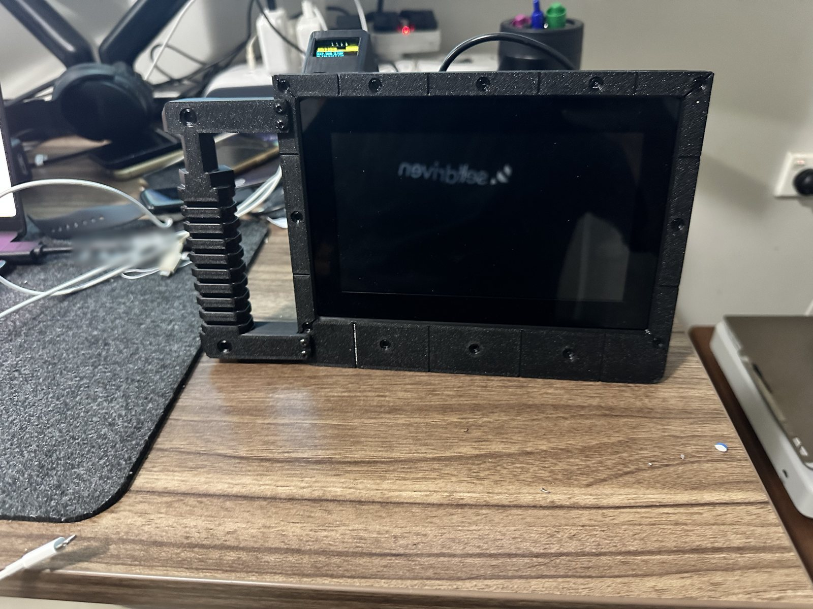

# Field Deck · the MK-I build

A Raspberry Pi 5 cyberdeck (7-inch touch screen, NVMe SSD, a two-cell battery UPS, a small HUD screen and an offline
voice assistant) in a 3D-printed case, the MK-I. This folder is the complete record of one build of the
[Field Deck guide](https://selfdriven.build/cyberdeck-build-guide) (its source is
[`docs/pages/cyberdeck-build-guide.html`](../../docs/pages/cyberdeck-build-guide.html)), from August to October 2026:
what it took, what went wrong, and every file you need to build another.



**Start here**

- **[BUILD_GUIDE.md](BUILD_GUIDE.md)**: the complete guide, v3.1. Parts, setup, printing the case, assembly, the HUD,
  the microphone and Octo, everyday use, troubleshooting.
- **[JOURNEY.md](JOURNEY.md)**: how it got here. A dated story of the build, the cases that didn't work, and the lessons.
- **[docs/ERRATA.md](docs/ERRATA.md)**: every correction to the original guide (E1–E37) and its status.

## What's in this folder

```
BUILD_GUIDE.md          the complete guide, start to finish (v3.1)
JOURNEY.md              the story of the build, with pictures of the earlier cases
CHANGELOG.md            what changed in each version
docs/
  ERRATA.md             every correction to the original guide (E1–E37)
  BOM.md                parts with the prices paid, the extras, the tools
  images/               photos of the finished deck and two diagrams used in the guide
  journey/              renders and photos used in JOURNEY.md
print/MK1-r9/           the six print files for the MK-I case (STL), how to print them, a picture of the plate
print/MK1-r9/extra/     the power lever (print 3) and the retainer ring the case also needs
cad/                    the design as STEP, the Fusion 360 scripts and build123d code it was made with, the checks
software/hud/           the HUD: one Python file and its systemd service
software/voice/         Octo, the voice assistant (octo.py r2) and the push-to-talk version (talk.py), with tests
software/archive/       an earlier, larger HUD package; never installed on the deck
config/                 the lines this deck adds to /boot/firmware/config.txt, and its bootloader config
concepts/               add-ons drawn but not built yet: a base dock, a camera pod, how the camera fixes on
MANIFEST.md5            every file with its checksum
```

## Status

One deck built, in daily use since 14 October 2026. Charging, battery, NVMe boot, the HUD, the microphone, speech to
text, the local model and speech out all work, and Octo r2 is confirmed on the deck. Not yet measured: a timed battery
run, and a 30-minute full-load heat test with the case closed. See *Still unverified* at the end of the guide.

## About this public copy

- **No personal names.** The printed deck's body has two first names cut into the bottom corners of its back. Here they
  are filled in: the body's print file, the STEP and the scripts carry no names (how, and the checks: the last section
  of [cad/README.md](cad/README.md#this-public-copy)). Every other print file is exactly what was printed.
- **No local details.** The HUD service runs as `YOURUSER` (the install line puts your own user in), and the Fusion
  scripts export to `/path/to/Field Deck/…`.
- **Five photos have a small blurred patch:** a card on the desk, a printed piece on the desk mat (in three of them), and
  the corner of the body where a name is cut.
- **Left out:** the working notes, the original photos, the making-of video (it shows the names), and the earlier case
  designs (v7, C1, R3, MK-I r1–r8). [JOURNEY.md](JOURNEY.md) has pictures of them.

## Size

About 24 MB in 168 files. The biggest are the design STEP (about 11 MB) and the print files; `.gitattributes` marks the binary
types and `.gitignore` keeps re-run output and video out of git.

## Licence

The same terms as the rest of this repository (see the repository root). Orbitron Bold, in `cad/fonts/`, is under the
SIL Open Font License.

---

*Designed in Fusion 360 with Claude · printed in PETG on a Bambu Lab A1 · [selfdriven.build](https://selfdriven.build)*
