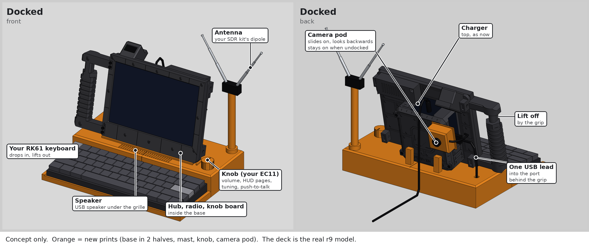
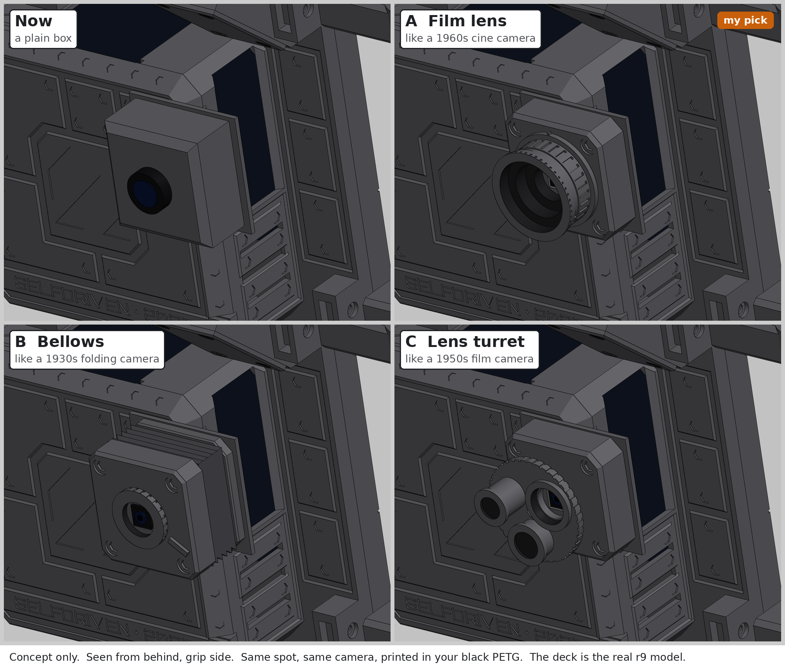
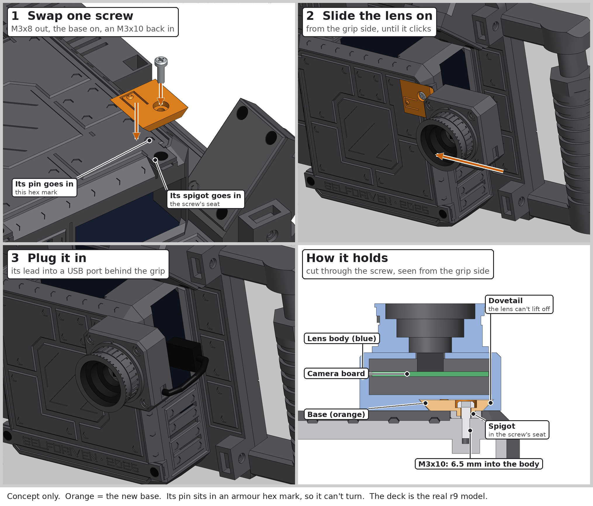

# Concepts: a base dock and a camera

Drawn on 21 October 2026 on the real r9 model of the deck. **Nothing here is built or ready to print**: these are the
pictures and checks that came before the design.

## The base dock



A base the deck stands in, so the keyboard, the radio, a knob and a speaker are all ready on a desk:

- **The deck** stands on its own 12° stand face on a spine at the back. It drops in and lifts out by the grip.
- **The keyboard** (a Royal Kludge RK61, 289 × 103 × 39 mm) sits in a well at the front.
- **A knob** (an EC11 encoder on a Raspberry Pi Pico 2, acting as a USB knob) sits top right: volume, HUD pages, tuning,
  push-to-talk.
- **The antenna**: the RTL-SDR V3 kit's dipole on a mast at the back right; the radio itself sits inside the base.
- **A speaker**: a small USB speaker under a grille in front of the screen (optional).
- **Inside**: a 4-port USB hub. Docking means one USB lead into a port behind the grip, and the charger in the top as
  usual.

The base is 304 × 226 mm, so it prints as two halves of 152 × 226 × 45 mm on a 256 mm bed. All the USB ports share the
Pi's 1.6 A USB budget; about 1 A is expected in normal use. Checks: [`dock_concept_checks.txt`](dock_concept_checks.txt)
(the deck sits on the base, the grip and the lips clear it, the power lever stays reachable). The mic's pinhole
sits 16.6 mm above the base, clear of its front lip.

## The camera pod: four looks



A USB camera (Arducam B0292, 8 MP autofocus, a 38 × 38 mm board) that looks backwards, away from the user, for pointing
at things. The plain box looked bolted on, so three retro looks were drawn; **the film lens (A) was picked**. Each lens
opening lets the camera's full 60 × 47° view through, and none touches the deck or the dock
([`camera_pod_looks_checks.txt`](camera_pod_looks_checks.txt)).

## How the film lens fixes on



1. **Swap one screw.** The back plate's top screw on the grip side comes out, a small printed base goes in its place, and
   an **M3 × 10** goes back through it. A spigot sits in the old screw's seat and a pin in one of the armour's hex marks,
   so the base can't turn. (An M3 × 8 is too short through the base; an M3 × 12 would hit the bottom of the hole.)
2. **Slide the lens on** from the grip side until it clicks: a dovetail holds it, and a springy tongue on the base
   clicks into a dimple.
3. **Plug its lead** into a USB port behind the grip (about 5 cm are needed; the camera comes with 1 m).

Checks: [`lens_fixing_checks.txt`](lens_fixing_checks.txt) — screw lengths against the real hole, the base's seat, the
dovetail's grip and clearances, the click's bend, the camera's view, the dock.

## Shopping list (as checked on 21–22 October 2026)

| Part | Where | Price |
|---|---|---|
| Arducam 8MP IMX219 autofocus USB camera (B0292) | Core Electronics, AC-B0292 | A$58.20 |
| Raspberry Pi Pico 2, for the knob | Core Electronics, CE09936 | A$8.70 |
| Mini external USB stereo speaker (optional) | Core Electronics, ADA3369 | A$28.60 |
| M3 × 10 pan-head screws, 25-pack | Core Electronics, POLOLU-2695 | A$4.30 |

Already owned: the RK61 keyboard, the EC11 encoder, the RTL-SDR V3 kit, the 4-port USB hub.

## The scripts

`cad-src/` holds the scripts that drew and checked these pictures (build123d, numpy, trimesh, Pillow). They were run
in a cloud workspace as a `dock/` package beside the modules in [`../../cad/build123d/`](../../cad/build123d/) (they
need `mock_render.py` from there). To run them again: copy those modules into a working folder, put this `cad-src/`
folder beside them as `dock/`, and point `FD_STEP` at the design STEP:

```bash
export FD_STEP=/path/to/lab/field-deck/cad/MK1-r9_design_public_NOT-FOR-PRINT.step
python3 dock/dock_concept.py            # writes the picture
python3 -m dock.dock_concept_check      # the checks
```

The pictures here were made from the public STEP (the body without the names).
